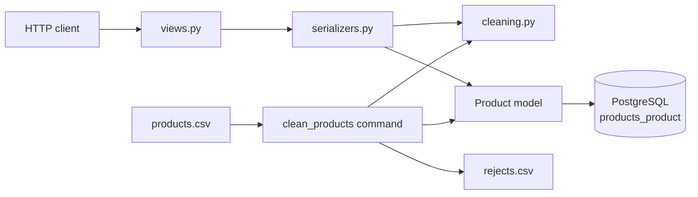
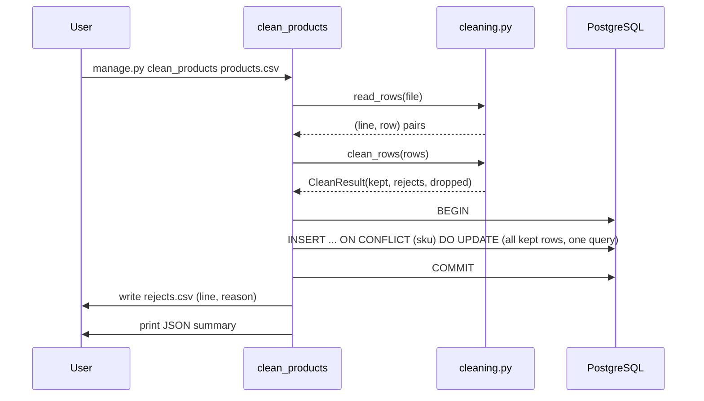

# Low-level design: Product list cleaner and API

This document describes how the service is built: its modules, data model, cleaning rules, request flows, and how it behaves on errors and concurrent writes. For setup and usage, see the [README](../README.md).

## 1. Scope

The service does two jobs:

1. **Import.** Read a supplier's product CSV, clean each row, drop duplicates, upsert the valid rows into PostgreSQL, and report what was rejected.
2. **Serve.** Expose the products through a REST API: list, fetch one by sku, and create.

Both jobs apply the **same cleaning rules**, so a product created through the API meets the same standard as one imported from the CSV.

Out of scope: authentication, update and delete endpoints, and deleting products that are missing from a later CSV.

## 2. Tech stack

| Layer | Choice |
|---|---|
| Language | Python 3.12 |
| Framework | Django 5.2 |
| API | Django REST framework 3.15+ |
| Database | PostgreSQL 17 through psycopg 3 (SQLite fallback for local runs without PostgreSQL) |
| Config | `POSTGRES_*` environment variables |

## 3. Module layout

```
config/
  settings.py        # DB from POSTGRES_* env vars, DRF defaults (JSON only, page size 5)
  urls.py            # mounts products.urls under /api/
products/
  cleaning.py        # all cleaning rules; plain Python, no Django imports
  models.py          # Product model
  serializers.py     # ProductSerializer, which calls cleaning.py for every field
  views.py           # list/create view and detail view
  urls.py            # /products/ and /products/<sku>/
  management/commands/clean_products.py   # CSV import command
  migrations/0001_initial.py              # creates products_product
  tests/             # test_cleaning.py, test_command.py, test_api.py
```



**Key rule:** `cleaning.py` imports nothing from Django. The import command and the API serializer are both thin wrappers around it, which keeps the rules in one place and lets them be unit tested without a database.

## 4. Data model

### 4.1 Table `products_product`

| Column | Type | Constraints | Notes |
|---|---|---|---|
| `id` | `bigint` | primary key, auto | Internal id. Not exposed by the API. |
| `sku` | `varchar(7)` | `UNIQUE`, not null | Business key, e.g. `LMP-001`. Always stored uppercase. |
| `name` | `varchar(255)` | not null | Trimmed; runs of spaces collapsed to one. |
| `category` | `varchar(20)` | not null | One of `lighting`, `seating`, `storage`. Stored lowercase. |
| `price_paise` | `integer` | `CHECK (price_paise >= 0)`, `CHECK (price_paise > 0)` | Price in paise (₹1 = 100 paise). Integer, never float. |
| `stock` | `integer` | `CHECK (stock >= 0)`, default `0` | |
| `updated_at` | `date` | not null | Comes from the file or the request, **not** `auto_now`, so re-imports write identical values. |

The `>= 0` checks come from `PositiveIntegerField`. The `price_paise > 0` check is the named constraint `product_price_paise_positive`. Default ordering is by `sku`.

### 4.2 Why these choices

- **Money as integer paise.** This avoids float rounding. `14,999.50` is parsed with `Decimal` and stored as exactly `1499950`.
- **`sku` as the business key.** Imports upsert on it and the API looks products up by it. The database `UNIQUE` index is the final guard against duplicates.
- **Checks in the database as well as in code.** Bad data can't get in even if the code path is skipped, for example by a manual insert in pgAdmin.

## 5. Cleaning rules (`cleaning.py`)

Each `clean_*` function takes a raw value and either returns the cleaned value or raises `CleaningError(reason, message)`.

| Field | Function | Accepts | Output | Reject reason |
|---|---|---|---|---|
| sku | `clean_sku` | 3 letters, `-`, 3 digits after trim and uppercase | `"LMP-001"` | `invalid_sku` |
| name | `clean_name` | Non-empty after trim; repeated spaces collapsed | `"Birch desk lamp"` | `missing_name` |
| category | `clean_category` | `lighting` / `seating` / `storage`, any case | `"lighting"` | `unknown_category` |
| price (CSV) | `clean_price` | Rupees; `₹`, commas and spaces stripped; up to 2 decimals; above 0 | `650000` (paise) | `invalid_price` |
| price_paise (API) | `clean_price_paise` | Whole number above 0 | `650000` | `invalid_price` |
| stock | `clean_stock` | Whole number 0 or more; empty means 0 | `4` | `invalid_stock` |
| updated_at | `clean_date` | Exactly `YYYY-MM-DD` and a real calendar date | `date(2026, 5, 3)` | `invalid_date` |

Implementation notes:

- Regexes use `[0-9]` instead of `\d`, so non-ASCII digits such as `٣` are rejected.
- `clean_date` checks the shape with a regex before calling `date.fromisoformat`, because on Python 3.11+ `fromisoformat` also accepts `20260502`.
- More than 2 decimal places in a price is **rejected**, not rounded.

### 5.1 Row and batch processing

| Function | Responsibility |
|---|---|
| `read_rows(fh)` | Uses `csv.reader` to yield `(line_number, row_dict)`. Checks that all required columns exist. Skips blank lines. Line numbers come from `reader.line_num`, so they stay correct when quoted values span lines. |
| `clean_row(row, line)` | Cleans the columns **in order**; the first failure decides the reject reason. Returns a frozen `CleanProduct`. |
| `drop_duplicates(products)` | Keeps one row per sku: the latest `updated_at` wins, and on a tie the row lower in the file wins. Returns the kept rows sorted by sku, plus the number dropped. |
| `clean_rows(rows)` | Runs the above and returns a `CleanResult(kept, rejects, duplicates_dropped)`. |

Only **valid** rows are deduplicated, so a broken row never knocks out a good row with the same sku.

## 6. Flow: CSV import

Command: `python manage.py clean_products <csv_path> [--rejects rejects.csv]`



Details:

- The file is opened with `utf-8-sig`, so a BOM from Excel doesn't break the `sku` header.
- All rows are saved with **one bulk upsert query**: `bulk_create(update_conflicts=True, unique_fields=["sku"], update_fields=UPSERT_FIELDS)`, which becomes `INSERT ... ON CONFLICT (sku) DO UPDATE` on PostgreSQL. This replaced an earlier `update_or_create` loop that sent a SELECT plus an INSERT or UPDATE per row.
- The upsert runs in **one transaction** (`@transaction.atomic` on `save`). The import fully succeeds or leaves the table unchanged.
- **Idempotent.** Running the command again on the same file writes the same values and prints the same summary.
- Products that aren't in the file, such as ones created through the API, are left alone.
- A missing file or missing columns raises `CommandError`, and nothing is written.

Output for the sample `products.csv`:

```json
{"loaded": 10, "rejected": {"invalid_sku": 1, "missing_name": 1, "unknown_category": 1, "invalid_price": 2, "invalid_stock": 3, "invalid_date": 1}, "duplicatesDropped": 3}
```

## 7. REST API

Base path `/api/`. JSON in and out only. No authentication.

| Method | Path | View | Success | Errors |
|---|---|---|---|---|
| GET | `/api/products/` | `ProductListCreateView` | 200, paginated list | none |
| GET | `/api/products/?category=lighting&page=2` | same | 200 | 404 for a page past the end |
| POST | `/api/products/` | same | 201, created product | 400 with one key per failing field |
| GET | `/api/products/<sku>/` | `ProductDetailView` | 200, one product | 404 |

### 7.1 Representation

```json
{
  "sku": "LMP-010",
  "name": "Reading lamp",
  "category": "lighting",
  "price_paise": 450000,
  "stock": 3,
  "updated_at": "2026-11-15"
}
```

List responses use DRF's `PageNumberPagination` (5 per page, ordered by sku):

```json
{"count": 10, "next": "http://.../api/products/?page=2", "previous": null, "results": [ ... ]}
```

### 7.2 Behaviour

- **List filter.** `?category=` is trimmed and lowercased. An unknown category returns an empty list, not an error.
- **Detail lookup.** The sku in the URL is trimmed and uppercased, so `/api/products/lmp-001/` finds `LMP-001`.
- **Create validation.** Each field is a `CleanedField` that calls the matching `clean_*` function. A `CleaningError` becomes a 400 for that field, and the error `code` is the reject reason.
- **Defaults on create.** `stock` defaults to `0` and `updated_at` to today in Asia/Kolkata.
- **Unique sku.** `UniqueValidator` checks the **cleaned** sku, so posting ` lmp-001 ` when `LMP-001` exists returns 400.

Example 400:

```json
{"sku": ["A product with this sku already exists."], "price_paise": ["Must be a whole number of paise above 0."]}
```

## 8. Transactions and concurrency

| Situation | Handling |
|---|---|
| Each API request | `ATOMIC_REQUESTS: True`, so every request runs in one transaction. |
| Two POSTs race on the same sku | Both pass `UniqueValidator`, and one then hits the database `UNIQUE` index. `ProductSerializer.create` wraps the insert in a nested `transaction.atomic()` (a savepoint) and turns the `IntegrityError` into a 400 on `sku`. The savepoint matters on PostgreSQL: without it, the failed insert would abort the whole request transaction. |
| Import while the API is writing | The import's upserts run in their own transaction. The last write to a sku wins. |
| Import fails part-way | The transaction rolls back, so no partial import is left behind. |

## 9. Configuration

Read in `config/settings.py`:

| Variable | Default | Purpose |
|---|---|---|
| `POSTGRES_NAME` | none | Database name. **If unset, SQLite (`db.sqlite3`) is used.** |
| `POSTGRES_USER` | none | Database role |
| `POSTGRES_PASSWORD` | none | Role password |
| `POSTGRES_HOST` | `localhost` | |
| `POSTGRES_PORT` | `5432` | |
| `DJANGO_SECRET_KEY` | dev-only value | Must be set outside local development |
| `DJANGO_DEBUG` | `1` | Set to `0` outside local development |

Values go in a local `.env` file (git-ignored), loaded with `set -a; source .env; set +a`.

The database role needs `CREATEDB`, because `manage.py test` creates and drops a `test_quixta_products` database.

## 10. Testing

Tests run with **pytest + pytest-django** (`pytest.ini` points at `config.settings`), with **coverage** through `./unit-tests.sh`, and use a **factory-boy** `ProductFactory` for API test data. `python manage.py test` also works. There are 30 tests:

| File | Covers |
|---|---|
| `test_cleaning.py` (10) | Price to paise and bad prices, name/sku/category cleaning, stock, dates, first failing column decides the reason, duplicate resolution (latest date wins, ties keep the lower row) |
| `test_command.py` (8) | Summary JSON for `products.csv`, rejects.csv contents, which duplicate is kept, cleaned values stored, re-running leaves the table the same, existing products updated and others kept, all rows saved in exactly one INSERT, missing file error |
| `test_api.py` (12) | Pages of 5 ordered by sku, result shape, category filter, detail and unknown sku 404, create (valid, cleaned like the command, stock default), 400 cases (bad category, duplicate sku, every failing field gets a key, missing required fields) |

Not yet covered: CSV reading edge cases (blank lines, quoted values spanning lines, missing columns), lowercase sku in the detail URL, and the concurrent-create `IntegrityError` path.

## 11. Known limitations and next steps

- **No authentication.** Any client can create products.
- **Whole file in memory.** The CSV is cleaned in memory and upserted in one query. For very large files, read and upsert in batches (`bulk_create(..., batch_size=...)`).
- **No update or delete endpoints.**
- **Import doesn't remove products** that disappear from the CSV.
- **Fixed categories.** The list lives in `cleaning.CATEGORIES`. Changing it needs a code change and a migration, because the model's `choices` come from it.
